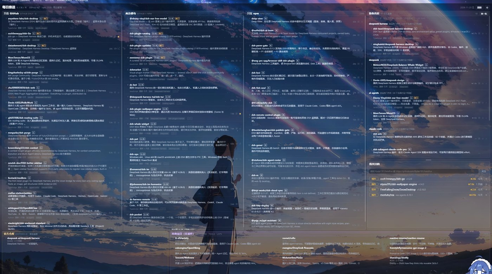

# 每日推送 · dsh-daily-push

> 在 DSH 侧栏里，把「今天有哪些新插件」变成一张能一眼扫完的榜。



一个给 [DeepSeek Harness](https://www.deepseek.com/download/) 用的插件发现面板：**GitHub 与 npm 全量对照**（两边各按 `owner/repo` 归一，每行标 `G` / `G∩N` / `N`）、三个榜单并列、官方仓库单独追踪、内置咨询和关注，支持中文关键词搜索。可以填一个 GitHub 令牌把抓取上限从 400 条提到 1000 条。

## 它解决什么问题

DSH 的插件生态在 GitHub 上，靠 `dsh-plugin` 标签自发聚集。问题是：

- 标签下的仓库已经上万，翻不过来；
- 按星数排，前面永远是被几个"顺手打了标签"的大项目占着（图片工具、简历生成器、系统清理器……）；
- 刚发布三小时的插件排在两千名外，但你其实最想看它；
- 看中一个，还得跳去 GitHub 读英文 README 才知道它干什么。

这个面板把这件事拆成四件：

1. **分开排** —— 星数、新建、活跃各一榜，互不干扰，你想看什么就点哪一列；
2. **看中文** —— 英文简介自动翻译，行一画出来就开始翻，翻好逐条替换；
3. **猜你喜欢** —— 只读扫一眼你自己的工作区、看板、会话标题，判断你缺什么能力，再去目录里找**真存在**的插件；
4. **搜得到** —— 中文说「书籍」，它自己换成 `book / ebook / epub` 去 GitHub 搜；像问题的话直接切「问模型」，按你已装的插件对比着回答。

## 界面

顶部一排是状态：`GitHub 660 · npm 2500 · 两边都有 167`，右边接着数据截止时间（`数据截至 11-19 14:30 · 6 小时前`）和 ⚙ 令牌入口。

主体四栏：

| 栏目 | 放什么 |
|---|---|
| 只在 GitHub | 打了 `dsh-plugin` 标签、但没发到 npm 的仓库，行首标 `[G]` |
| 两边都有 | 同一个 `owner/repo` 在两边都出现，行首标 `[G∩N]`；名字与简介取 GitHub，包名与安装命令取 npm |
| 只在 npm | 发到 npm、但 GitHub 上没打标签的包，行首标 `[N]`，右侧显示下载量 |
| 猜你喜欢 · 我关注的 | 右侧一列：扫本机画像推给你的插件（最多 5 个，点「×」不再出现）；下面是点过 ☆ 的项目 |

每列默认 15 行，底部「再加载 15 条」按列独立翻页，翻到底显示「没有更多了」。右栏上下两块的分界可以拖：把「我关注的」上沿那道横条往上拖就变高（最多到栏高的 66%，再双击横条按内容还原），关掉再开也记得。三列下面是官方仓库（单独追踪）和其他项目（非插件）。

## 安装

```bash
dsh plugin add dsh-daily-push
```

装完重启 DSH，左侧栏会出现「每日推送」。

也可以直接从 GitHub 装（跟 npm 版同一份代码）：

```bash
dsh plugin add git+https://github.com/aaa8leitingpifa/dsh-daily-push
```

要求：

- DSH **≥ 0.2.1-rc.1**
- Node **≥ 22**
- 可访问 `api.github.com`（未登录时核心接口 60 次/小时、搜索 10 次/分；全量数据落盘缓存 6 小时，填令牌可提高上限）

卸载：

```bash
dsh plugin remove dsh-daily-push
```

## 功能

### 三个榜，各排各的

| 榜 | 排序 | 回答的问题 |
|---|---|---|
| **星数榜** | 全部 `dsh-plugin` 里星最多的 | 大家都在用什么 |
| **新建榜** | 最近 30 天建库的 | 有什么新东西 |
| **活跃榜** | 最近 10 天有 push 的 | 谁还在维护 |

每行三行字：仓库名 + 星数 / 中文简介（最多两行）/ 语言 · 更新时间 · 标签。

### 搜索：中文输入，英文去搜

GitHub 的搜索不认中文——直接拿「书籍」去搜，命中率接近零。所以输入框里的中文先在本地翻成英文（内置 49 组场景词表，一个词能扩出同义、近义、英文三档权重），再拿英文去查：

```
你打「书签」
  ↓ 本地扩展（只扩一层，不递归）
bookmark 1.0 · 收藏夹 0.6 · readlater 0.45 · tabs 0.55 …
  ↓
GitHub：bookmark OR readlater OR tabs topic:dsh-plugin
```

结果分两栏：

- **全量命中** —— GitHub 全量 + npm 全量合并后的三千多条里本地筛，点完即出，不花额度；
- **GitHub 全站** —— 再让 GitHub 实时搜一遍补漏，约 1 秒，宿主缓存 10 分钟。

在 `∩` 合并屏里搜索不会切走：三列就地按关键词筛，省掉一次远端请求。

输入框下面一排常用词（**这周有什么值得装的 · 能干什么 · 有什么坑 · 和我装的重复吗 · 有没有替代品**），点一下就在面板内切到咨询页；输入本身像问题时（带问号、含「值不值 / 能不能 / 怎么 / 有没有」，或者一长串词）也会多给一个「问模型：…」按钮——**只给按钮，不自动发送**。咨询页左上角「← 返回列表」，返回后搜索词和列表都还在。目录里一条都没命中时，同样给一条「把这个词问给模型」。

英文词最多带 3 个。这个词数是试出来的：6 个词时 `dsh-mobile-*` 这类无关插件会挤满列表，3 个词时前几名基本都对得上。

### 场景分类：不知道搜什么的时候

搜索框下面一排场景卡：**读书 · 视频 · 笔记 · 文档 · 图片 · 界面 · 壁纸 · 搜索 · 记忆 · 翻译 · 开发 · 待办**，点一下等于一次搜索（用的是整组词，不是单个词）。点「全部分类 ›」能看到全部 49 组。输入框一有字，这排卡会自动收起，不挤占空间。

### 三源对照：G / ∩ / N

标题右边的三个字母是一个开关，**三个字母各自可点**：

| 视图 | 数据来源 | 三列 |
|---|---|---|
| **G** | GitHub `topic:dsh-plugin` | 星数榜 / 新建榜 / 活跃榜 |
| **∩** | GitHub 全量 × npm 全量，按 `owner/repo` 归一求交 | 只在 GitHub / 两边都有 / 只在 npm |
| **N** | npm `keywords:dsh-plugin` | 最新发布 / 最常被用（本周下载）/ npm 推荐（相关度） |

**两边都是全量，不是采样。** GitHub 侧按 stars 与 updated 各翻 10 页（搜索接口每个查询最多只给前 1000 条），npm 侧翻 10 页拿满 2500 条（接口上限），都落盘缓存 6 小时。

- 未登录 GitHub 时只抓 7 页（约 660 条）：搜索接口未登录限 10 次/分，抓多了必然 403。填了令牌就是 20 页、最多 1000 条。
- 每行名称后面的小角标就是来源：`G` 只在 GitHub、`G∩N` 两边都有、`N` 只在 npm。合并行的元数据（星数、更新时间、简介）取 GitHub，包名与安装命令取 npm。
- 每列先画 15 条，点「再加载」加 15 条，到底显示「没有更多了」。数据一直在内存里，翻页只是改显示条数，不复制行。

### GitHub 令牌（可选）

未登录时 GitHub 搜索是 10 次/分、每个查询最多只能拿到 1000 条里的前 400 条，抓全量要 7 页、约 10 秒。填一个令牌（classic 或 fine-grained 都行，**不需要任何 scope**，只读公共仓库）之后搜索额度变成 30 次/分，能翻到 1000 条。

右上角 ⚙ → 「GitHub 令牌」：

- 粘贴令牌 → 保存：宿主先拿它请求 `/rate_limit` 校验，通了才写盘；
- 令牌存在 `DSH_HOME/daily-push-token.json`（权限 600），**不进浏览器 localStorage、不进页面源码**，前端只显示「已配置 · 尾号 xxxx」；
- 「测试」按钮当场验一遍并显示剩余额度；「清除」删掉文件回到未登录状态；
- 也可以用环境变量 `GITHUB_TOKEN`（或 `DSH_GITHUB_TOKEN` / `GH_TOKEN`），文件优先。

### 一键拿到安装命令

每行右侧有个「装」，点一下复制完整命令：

| 这一行来自 | 复制的命令 |
|---|---|
| npm / 两边都有 | `dsh plugin add <包名>` |
| 只在 GitHub | `dsh plugin add git+https://github.com/<owner>/<repo>` |

`git clone` 是不管用的——clone 下来的代码 DSH 并不认识，必须走 `plugin add` 才会写进 profile 依赖、登记到 `dsh.profile.bundles`。

### 官方仓库单独追踪

`deepseek-ai` 组织下与 DSH 相关的仓库不混进榜单，单独一张金边卡片，永远第一眼能看到官方发版。

### 其他项目（非插件）

GitHub 上还有一批和 DSH 相关但不是插件的东西——桌面客户端、模板、清单、工具。它们单独占一块，不会污染三个榜。

### 猜你喜欢：看你在做什么，再推荐

榜单回答的是「有哪些插件」，回答不了「我该装哪个」。这块先只读扫一遍本机：

| 读什么 | 默认 |
|---|---|
| 工作区文件与目录名 | 全部（本机实测 354 个文件 / 682 个目录） |
| 任务看板、近期会话**标题** | 都读，不读正文 |
| 会话**正文** | 默认不读；⚙ 里勾选 1–3 个才带 |

只把结构摘要（约 3 千字，零网络）交给当前模型，让它出一份「你缺什么能力」的清单，再拿清单里的英文关键词去三千多条真实目录里检索。**命中不了的需求直接不显示**，宁可少一条也不凑数；一条需求最多 2 行，同一个插件不会挂在两条需求下。

- 行尾「×」= 不感兴趣，记在 localStorage，同一条目不再出现；
- 顶部「换一批」= 重新扫一次（模型重新出清单）；
- ⚙ 里「看看这次会发什么」= 只显示摘要文本，不调模型，先看清再决定；
- ⚙ 里还能勾选要把哪几个会话的正文一起发（最多 3 个）。

### 咨询（现在在搜索框里）

贴一个仓库链接、仓库名（支持只有半截的，比如 `rea`、`逆向`），或者干脆一句话描述，问：

- 值得装吗
- 能干什么
- 有什么坑
- 和我的重复吗

回答会带上「参考」条：仓库可以点开，可以一键复制 `git clone`，可以直接下 ZIP。用的是你自己配的模型，不额外收费。

### 关注

榜单每行右边有个 ☆，点一下加入关注。关注列表会跟踪版本变化，**不限于插件**：skill、软件、普通项目都能关注，它会自动判断类型。

### 已装插件更新提醒

「插件动态」标签页跟踪你已经装的插件，有新版本时用中文功能名告诉你：

```
侧边栏增强  better-sidebar  有新版本 0.28.2（当前 0.24.1）
```

### 外观

右上角 ⚙：

| 设置 | 选项 |
|---|---|
| 字号 | 紧凑 / 标准 / 宽松 |
| 浓度 | 透 / 中 / 实（面板透明度） |
| 磨砂 | 开 / 关（省内存） |
| 主题 | 跟随系统 / 深色 / 浅色 |

设置存在浏览器 localStorage，不上传。

## 数据从哪来

| 用途 | 来源 |
|---|---|
| 三个榜 | GitHub Search API：`topic:dsh-plugin`，分别按 stars / created / pushed 排序 |
| 官方仓库 | GitHub API：`orgs/deepseek-ai/repos` |
| 关注与更新 | GitHub API：仓库元数据 + releases |
| 旧榜单兜底 | 本机 `dsh-recommend` 插件的 `registry.json`（可选，没有也能跑） |
| 全站搜索 | GitHub Search API：`<英文词> OR … topic:dsh-plugin`，宿主缓存 10 分钟 |
| `∩` 全量对照 | GitHub Search（stars × 10 页 + updated × 10 页，每查询上限 1000）× npm Search（10 页 × 250 = 2500 条），按 `owner/repo` 归一，磁盘缓存 6 小时 |
| npm 视图 | npm Registry：`keywords:dsh-plugin` 搜索（接口单次上限 250 条） |
| 本周下载量 | `api.npmjs.org/downloads/point/last-week/<包名>`（批量 128 个/请求），磁盘缓存 6 小时 |
| 令牌校验 | GitHub `/rate_limit`（免费，不计额度） |
| 翻译与咨询 | 你当前配置的模型（走 DSH 宿主，不直连第三方） |

**没有遥测**，不收集任何使用数据，不向除 `api.github.com`、`registry.npmjs.org` 和你自己的模型之外的服务发请求。

## 性能

- 面板不轮询，只在打开、点刷新、切标签时请求；
- 榜单结果缓存 10 分钟，翻译结果落盘缓存（最多 3000 条）；
- **N 视图首屏约 1 秒**：先拿 2500 条元数据就画出来，下载量在后一趟补（约 2 秒），所以「最常被用」那列会先按相关度排、随后跳成按下载排；
- **∩ 视图首次约 10–30 秒**：慢在 GitHub 那 7–20 页（搜索接口只能串行、页间要留间隔），npm 10 页约 3 秒；结果落盘，之后 6 小时内打开是 0 请求；
- 合并三千多条只在内存里做一次 `Map` 归一，约 10 毫秒；每列只渲染 15 行，翻页是改显示条数、不复制行，点 20 次也只有几百个 DOM 节点；
- 面板关闭后不占后台请求；打开时会在后台预热 npm 数据，所以点 N 基本是秒开；
- 磨砂背景可以关掉（设置里「磨砂 → 关」），省一部分合成开销。

## 常见问题

**榜是空的 / 全是几个月前的？**
榜单依赖 GitHub Search。被限流时（未登录搜索 10 次/分、核心 60 次/小时），面板会退回本机快照并标注「旧榜单快照 N 天未更新」，或者只让 GitHub 那两列报错、npm 列照常。等几分钟或填个令牌即可。

**第一次打开 ∩ 很慢？**
要翻 GitHub 7–20 页 + npm 10 页，首次 10–30 秒；抓完写进 `DSH_HOME/cache/daily-push-all.json`，6 小时内再打开是 0 请求，点刷新才会重抓。

**令牌会不会被上传？**
不会。令牌只存在宿主侧 `DSH_HOME/daily-push-token.json`（权限 600），接口只回「已配置 · 尾号」，页面源码和 localStorage 里都没有原文。

**为什么「只在 GitHub」比「只在 npm」少？**
GitHub 侧受搜索接口 1000 条上限约束（未登录 660 条），npm 能拿满 2500 条；两边都是全量口径，但总量本身不同，所以窄的那侧天然少。

**为什么有的仓库显示"作者还没写简介"？**
它在 GitHub 上确实没填 `description`，不是抓取失败。

**翻译要多久？**
首屏先显示英文，翻译在后台分批跑（一批 15 条），几秒内逐条替换。只翻**画出来的行**：翻到第几页翻第几页，不会为了三千多条一次问光；翻过的落盘缓存，下次打开直接出中文。

**它会不会和 dsh-plugin-radar 冲突？**
功能有重叠（都是从 `dsh-plugin` 标签发现插件），但形态不同，可以同时装。这边更偏"三榜 + 咨询 + 关注"，它更偏"定时推送卡片流"。

## 更新日志

- [CHANGELOG.md](CHANGELOG.md) —— 逐版变更
- [docs/release-0.2.0.md](docs/release-0.2.0.md) —— 0.2.0 更新报告（全量对照、令牌、翻页）

## 许可

MIT
